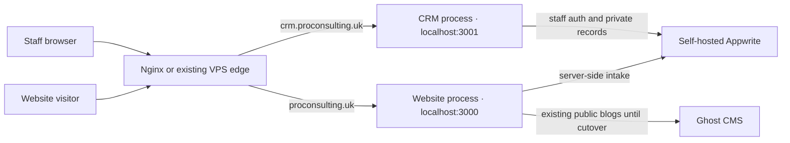

# Architecture

## Target topology

Both Node processes use the **same React Router build** and repository. This is a VPS deployment, not a separate Sites-hosted application. `APP_SURFACE` distinguishes the processes. Nginx routes hostnames without rewriting React Router paths. The CRM's root redirects to `/admin`.

## Request paths

Public forms → same-origin `/api/leads` or the education assessment action → validation, rate limiting, idempotent persistence → private Appwrite `leads` collection → verified success response.

Staff browser → `/admin/login` → server creates Appwrite session → signed, host-only HttpOnly cookie → each protected loader/action verifies account and active staff profile → central operation/record policy → private Appwrite documents.

Staff CMS → sanitized HTML and metadata → Appwrite `posts`. Public adapters now call a shared `/api/content` service, which defaults to **Ghost**. `BLOG_PROVIDER=appwrite` enables published-only Appwrite reads after migration gates pass. Appwrite-backed public content, migration, scheduling, and asset cutover remain separate rollout gates.

## Security boundaries

- Dashboard mutations require same-origin requests; staff cookies are not shared across subdomains.
- API keys remain server-only and bypass Appwrite record permissions, so every handler must apply the central policy.
- Collections are private with no public grants. Client-side hiding is not authorization.
- Counselors access assigned leads. Content roles do not access CRM records. Managers currently have organization-wide access; team scoping is planned.
- Staff pages omit the public site's Google/Meta tracking snippets.
- The existing one-process deployment remains the conservative configuration. Cross-process private record locks are now staged for dashboard/worker coordination; crash recovery and concurrency still require acceptance checks. The background worker is disabled by default in PM2 and has not been started on the VPS.

See [[04 Decisions]], [[06 Deployment]], and [[07 Data and Permissions]].

## Editorial media and HTTPS deployment increment

MEDIA-01 now uses a server service for upload/visibility policy, bounded multipart parsing, stable file/metadata IDs and recoverable audit intents. The bucket and metadata remain private; only publisher-approved images stream from the public application route with no-store. The website must receive that accepted route build before its URLs work; CRM-only startup leaves the existing public release intact. See `docs/EDITORIAL-MEDIA.md`.

The day-one Nginx path has separate certificate-only HTTP bootstrap and final HTTPS vhosts. React Router `/admin.data` and `/__manifest` forwarding are required alongside staff routes/assets. Startup instructions explicitly select only the CRM process and preserve the public website/Appwrite edge. Actual VPS routing/TLS validation remains an operations gate.

## REMIND-01 due-task delivery

The opt-in reminder process is now independent of publishing and unaccepted case/calendar features. It queries paginated due open tasks, takes a cycle lock and the same per-lead lock as assignment/task changes, rechecks current state/active assignee and creates a deterministic private notification. The document write is durable in-app delivery; there is no external-send side effect. The inbox rechecks current task generation/lead owner, so stored stale reminders remain hidden. Complete/Cancel/Reschedule update task versions under that shared lock.

Private worker health and Workspace setup show cycle/last-success/error state, with stale detection after three minutes. Safe shutdown finishes the current task and stops between tasks; forced crashes retain fail-closed locks requiring operator recovery. See `docs/IN-APP-REMINDERS.md`. No worker has been activated on the VPS.

## CASE-01 acceptance — 7 November 2026

CASE-01 locally accepted: both service forms require appropriate identifying fields/destination and an active CRM assignee; stage choices match service and existing service is fixed. Keyed forms refresh saved values on navigation/version change; missing records return 404. Focused tests cover permissions, stale forms, independent records, audit failures, ambiguous writes, paginated handoff and interrupted-transfer retry. Actual built-app browser exercised both service creations, deadline normalization/display, independent list states, fixed service and second-tab stale rejection. Existing private cases schema checked read-only. Production rollout and case-reminder adapter remain separate gates. See `docs/APPLICATION-WORKFLOWS.md` and `tests/manual/CASE-01-browser.md`.

## CAL-01 appointment acceptance

Appointments and lead handoffs acquire the lead lock, then the shared calendar lock. This protects current assignment and reserves overlapping slots consistently across different leads. Current lead ownership still controls counselor visibility.

## DOC-01 private documents

The staff route validates a bounded request and checks the lead before sending bytes to a trusted local ClamAV socket. A clean verdict and a second scope check under the shared lead lock precede private Appwrite storage and metadata. The download route authorizes against current lead ownership and records an audit intent before streaming an attachment. Upload intent IDs tie metadata and stored files together for reconciliation.

## TEAM-01 staff access

Staff edits use the shared staff access lock. Lead reassignment acquires the lead lock, staff access lock, then the calendar lock. The acting staff role and target eligibility are checked inside the protected handoff. Inactive profiles are denied on each new CRM request while Appwrite session revocation is attempted.

## REPORT-01 operational reports

The report reads private lead projections in stable ID order and aggregates them server-side. CSV uses the same pagination with a separate field allowlist, checks the staff session again, then records the audit before returning an attachment.

## CRM-02 manual entry and contact search

Public intake and staff entry write normalized email and phone keys. Scoped lead queries use the indexed keys for exact contact lookup and retain the name full-text search. The new search form submits terms in the request body and list results project only the displayed lead fields.

## Consultation tracking

Completed consultations use a private collection keyed by enquiry, credited staff member and destination. Lead history checks current enquiry scope. The management report filters by counselor and normalized destination and projects only the names needed for enquiry links.

## MOB-01 mobile staff workspace

The Expo/React Native app lives in the sibling `Proconsulting-App` folder. Its native browser view loads the responsive CRM over HTTPS, retaining server-managed authentication and feature permissions. The mobile shell adds navigation and a browser handoff for downloads. The CRM exposes its sign-out control at phone widths.

## Native staff workspace

The sibling Expo app renders staff sign-in, leads and open follow-ups with React Native views. It calls the versioned JSON resource under `/admin/mobile/v1/` on the CRM origin. Appwrite staff identity and the same role and record scope used by the dashboard are checked on each snapshot. The native session bearer is encrypted and expires after at most eight hours. The mobile app holds it in memory. The dashboard continues to use its browser session cookie and supports the full CRM and CMS. See [[Sessions/2026-11-11-05]].
