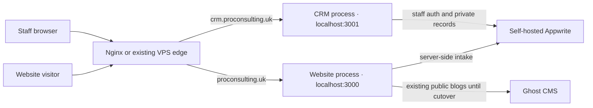

# Architecture

## Target topology

Both Node processes use the **same React Router build** and repository. This is a VPS deployment, not a separate Sites-hosted application. `APP_SURFACE` distinguishes the processes. Nginx routes hostnames without rewriting React Router paths. The CRM's root redirects to `/admin`.

## Request paths

Public forms → same-origin `/api/leads` or the education assessment action → validation, rate limiting, idempotent persistence → private Appwrite `leads` collection → verified success response.

Staff browser → `/admin/login` → server creates Appwrite session → signed, host-only HttpOnly cookie → each protected loader/action verifies account and active staff profile → central operation/record policy → private Appwrite documents.

Staff CMS → sanitized HTML and metadata → Appwrite `posts`. Public adapters now call a shared `/api/content` service, which defaults to **Ghost**. `BLOG_PROVIDER=appwrite` enables published-only Appwrite reads after migration gates pass. Appwrite-backed public content, migration, scheduling, and asset cutover remain separate rollout gates.

## Security boundaries

- Dashboard mutations require same-origin requests; staff cookies are not shared across subdomains.
- API keys remain server-only and bypass Appwrite record permissions, so every handler must apply the central policy.
- Collections are private with no public grants. Client-side hiding is not authorization.
- Counselors access assigned leads. Content roles do not access CRM records. Managers currently have organization-wide access; team scoping is planned.
- Staff pages omit the public site's Google/Meta tracking snippets.
- The existing one-process deployment remains the conservative configuration. Cross-process private record locks are now staged for dashboard/worker coordination; crash recovery and concurrency still require acceptance checks. The background worker is disabled by default in PM2 and has not been started on the VPS.

See [[04 Decisions]], [[06 Deployment]], and [[07 Data and Permissions]].
