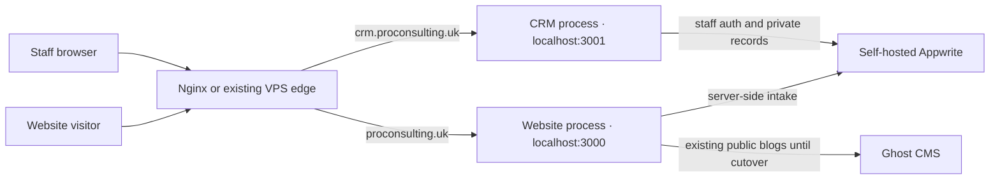

# Architecture

## Target topology

Both Node processes use the **same React Router build** and repository. This is a VPS deployment, not a separate Sites-hosted application. `APP_SURFACE` distinguishes the processes. Nginx routes hostnames without rewriting React Router paths. The CRM's root redirects to `/admin`.

## Request paths

Public forms → same-origin `/api/leads` or the education assessment action → validation, rate limiting, idempotent persistence → private Appwrite `leads` collection → verified success response.

Staff browser → `/admin/login` → server creates Appwrite session → signed, host-only HttpOnly cookie → each protected loader/action verifies account and active staff profile → central operation/record policy → private Appwrite documents.

Staff CMS → sanitized HTML and metadata → Appwrite `posts`. Public adapters now call a shared `/api/content` service, which defaults to **Ghost**. `BLOG_PROVIDER=appwrite` enables published-only Appwrite reads after migration gates pass. Appwrite-backed public content, migration, scheduling, and asset cutover remain separate rollout gates.

## Security boundaries

- Dashboard mutations require same-origin requests; staff cookies are not shared across subdomains.
- API keys remain server-only and bypass Appwrite record permissions, so every handler must apply the central policy.
- Collections are private with no public grants. Client-side hiding is not authorization.
- Counselors access assigned leads. Content roles do not access CRM records. Managers currently have organization-wide access; team scoping is planned.
- Staff pages omit the public site's Google/Meta tracking snippets.
- The existing one-process deployment remains the conservative configuration. Cross-process private record locks are now staged for dashboard/worker coordination; crash recovery and concurrency still require acceptance checks. The background worker is disabled by default in PM2 and has not been started on the VPS.

See [[04 Decisions]], [[06 Deployment]], and [[07 Data and Permissions]].

## Editorial media and HTTPS deployment increment

MEDIA-01 now uses a server service for upload/visibility policy, bounded multipart parsing, stable file/metadata IDs and recoverable audit intents. The bucket and metadata remain private; only publisher-approved images stream from the public application route with no-store. The website must receive that accepted route build before its URLs work; CRM-only startup leaves the existing public release intact. See `docs/EDITORIAL-MEDIA.md`.

The day-one Nginx path has separate certificate-only HTTP bootstrap and final HTTPS vhosts. React Router `/admin.data` and `/__manifest` forwarding are required alongside staff routes/assets. Startup instructions explicitly select only the CRM process and preserve the public website/Appwrite edge. Actual VPS routing/TLS validation remains an operations gate.

## REMIND-01 due-task delivery

The opt-in reminder process is now independent of publishing and unaccepted case/calendar features. It queries paginated due open tasks, takes a cycle lock and the same per-lead lock as assignment/task changes, rechecks current state/active assignee and creates a deterministic private notification. The document write is durable in-app delivery; there is no external-send side effect. The inbox rechecks current task generation/lead owner, so stored stale reminders remain hidden. Complete/Cancel/Reschedule update task versions under that shared lock.

Private worker health and Workspace setup show cycle/last-success/error state, with stale detection after three minutes. Safe shutdown finishes the current task and stops between tasks; forced crashes retain fail-closed locks requiring operator recovery. See `docs/IN-APP-REMINDERS.md`. No worker has been activated on the VPS.

## CASE-01 acceptance — 7 November 2026

CASE-01 locally accepted: both service forms require appropriate identifying fields/destination and an active CRM assignee; stage choices match service and existing service is fixed. Keyed forms refresh saved values on navigation/version change; missing records return 404. Focused tests cover permissions, stale forms, independent records, audit failures, ambiguous writes, paginated handoff and interrupted-transfer retry. Actual built-app browser exercised both service creations, deadline normalization/display, independent list states, fixed service and second-tab stale rejection. Existing private cases schema checked read-only. Production rollout and case-reminder adapter remain separate gates. See `docs/APPLICATION-WORKFLOWS.md` and `tests/manual/CASE-01-browser.md`.

## CAL-01 appointment acceptance

Appointments and lead handoffs acquire the lead lock, then the shared calendar lock. This protects current assignment and reserves overlapping slots consistently across different leads. Current lead ownership still controls counselor visibility.

## DOC-01 private documents

The staff route validates a bounded request and checks the lead before sending bytes to a trusted local ClamAV socket. A clean verdict and a second scope check under the shared lead lock precede private Appwrite storage and metadata. The download route authorizes against current lead ownership and records an audit intent before streaming an attachment. Upload intent IDs tie metadata and stored files together for reconciliation.

## TEAM-01 staff access

Staff edits use the shared staff access lock. Lead reassignment acquires the lead lock, staff access lock, then the calendar lock. The acting staff role and target eligibility are checked inside the protected handoff. Inactive profiles are denied on each new CRM request while Appwrite session revocation is attempted.

## REPORT-01 operational reports

The report reads private lead projections in stable ID order and aggregates them server-side. CSV uses the same pagination with a separate field allowlist, checks the staff session again, then records the audit before returning an attachment.

## CRM-02 manual entry and contact search

Public intake and staff entry write normalized email and phone keys. Scoped lead queries use the indexed keys for exact contact lookup and retain the name full-text search. The new search form submits terms in the request body and list results project only the displayed lead fields.

## Consultation tracking

Completed consultations use a private collection keyed by enquiry, credited staff member and destination. Lead history checks current enquiry scope. The management report filters by counselor and normalized destination and projects only the names needed for enquiry links.

## MOB-01 mobile staff workspace

The Expo/React Native app lives in the sibling `Proconsulting-App` folder. Its native browser view loads the responsive CRM over HTTPS, retaining server-managed authentication and feature permissions. The mobile shell adds navigation and a browser handoff for downloads. The CRM exposes its sign-out control at phone widths.

## Native staff workspace

The sibling Expo app renders staff sign-in, leads and open follow-ups with React Native views. It calls the versioned JSON resource under `/admin/mobile/v1/` on the CRM origin. Appwrite staff identity and the same role and record scope used by the dashboard are checked on each snapshot. The native session bearer is encrypted and expires after at most eight hours. The mobile app holds it in memory. The dashboard continues to use its browser session cookie and supports the full CRM and CMS. See [[Sessions/2026-11-11-05]].

The native lead resource also reads and updates stage and priority. It uses the web dashboard's lead mutation service with the existing version check, authorization, closure reason and audit. Native writes preserve assignment and follow-up values. See [[Sessions/2026-11-11-06]].

Staff follow-ups, applications and appointments now page through scoped records. Related lead checks deduplicate IDs within a page and limit concurrent reads. The native follow-up endpoint serves subsequent pages independently. Public enquiry intake bounds the body as bytes arrive.

Native lead search and pagination reuse the web dashboard query with a POST body for contact search terms. See [[Sessions/2026-11-15-01]].

## Matching enquiry review — 2026-11-15

Lead detail now reads matching enquiries by normalized email or phone through the existing server-side Appwrite boundary. Matching does not establish a canonical contact or merge records.

## Confirmed contact links

Confirmed contact groups are manager-only. An optional group ID links separate enquiries; case, assignment and follow-up relationships keep their original enquiry IDs.

## Duplicate enquiry decisions

Duplicate resolution archives an enquiry with a retained-enquiry reference and previous stage. The decision is audited; both records stay intact.

## Saved lead views

Saved lead filters use a private Appwrite collection keyed by staff and filter combination. Opening a view runs the existing scoped lead search.

## Bulk lead changes

Bulk stage and priority changes call the existing lead mutation for each selected enquiry. They preserve the assignee and next follow-up.

## Bulk counselor handoff

Bulk assignment reuses the single enquiry transfer under lead, staff access and calendar locks. The manager filter adds an indexed owner condition to the scoped lead query.

## Counselor routing

Manager-triggered routing evaluates candidates under the lead and staff-access locks. The lead write records rotation metadata with the new owner. The normal handoff transfers linked work.

## Automatic intake routing

Public intake marks opted-in new records for the separate worker. Assignment uses the existing locked handoff policy; updates clear the marker when an enquiry is assigned or leaves New.

Branch and team authorization boundaries and current call paths are mapped in [[Sessions/2026-11-16-02]].

## Team-scoped lead workspace

The first restricted-manager slice joins staff to an active private team directory record and reads enquiries by indexed teamId. Web lead routes opt in; other workspace surfaces deny restricted managers by default.

## Team classification tooling

Team classification tools scan private directory, staff and enquiry metadata for aggregate counts. A reviewed manifest fills empty lead team references under existing locks.

## Team directory administration

The Team & access route maintains the directory and configures manager scope under the shared staff-access lock.

## Team linked work queues

Restricted linked queues first resolve current team enquiry IDs, then query linked records and recheck each visible parent. Summary fields are projected.

## Team follow-up edits

Follow-up updates use the parent lead lock and staff-access lock for team managers, then recheck live membership and parent scope before mutation.

## Team application edits

Scoped application writes acquire the parent lead and staff-access locks and recheck current scope, ownership and version.

## Team appointment edits

Team appointment edits reuse existing calendar rules under lead, staff access and calendar locks.

## Team aggregate reports

Aggregate scans filter and verify every page by current team and refresh the staff session before releasing restricted totals.

## Team CSV export

Team CSV reuses the verified paginated scan and confirms current scope before and after the audit.

## Team consultation reads

Team consultation reports reuse the current parent enquiry queue and recheck team when resolving customer names.

## Team consultation recording

Consultation recording shares the existing lead and staff-access locks. The team-manager path rechecks live actor, directory, parent and counselor scope.

## Team document checklist

Team document lists use a restricted metadata projection and verify current parent team again after pagination.

## Team private downloads

The download route audits access and refreshes current team and parent before opening the private storage stream.

## Team document reviews

Team document review reuses the lead and staff-access locks and rechecks current team before writes.

## Team document uploads

Team uploads reuse private storage, scan, audit and recovery. Membership is rechecked under the lead and staff-access locks after scanning.

## Appointment reminders

The reminder worker can scan the next hour of booked appointments and reuse private notification storage.

## Case deadline reminders

The reminder worker can scan active case deadlines over the next 24 hours.

## Resend outbox

Resend email requests use a private Appwrite outbox and separate opt-in worker.

## Staff reminder email

In-app reminders can enqueue generic staff email. The outbox sender holds the lead and staff locks while checking the current source and verified Auth address.

## Resend delivery events

The website accepts signed Resend events and stores a private ledger. The email worker reads bounce and complaint suppression.

## Email delivery operations

The CRM email delivery page reads private outbox and event storage through projected server queries.

## Staff email preferences

Workspace setup changes only the signed-in staff member’s preference under the shared staff access lock. The email worker checks it before queueing and again under that lock before transport.

## Staff email pilot

The integrated local pilot connects the reminder producer, outbox, provider adapter, website callback and admin counts through one simulated Appwrite store.

## Linked contact profiles

Confirmed contact profiles are read-only views anchored to a linked enquiry. Group membership comes from the current contact group on that enquiry.

## Duplicate enquiry review

The duplicate review page uses the same dependency checks as the archive action. The action repeats those checks with both enquiries and staff access locked.

## Duplicate merge planning

The duplicate review can load an on-demand comparison of both enquiries. It reads aggregate dependency counts and assignment differences through the same global CRM role gate as archive review.

## Duplicate follow-up transfer

Duplicate review can move one open task under both enquiry locks and the staff access lock. Both enquiry versions and the task version are checked again before the write.

## Office expenses

Office expenses use a shared server service for the web route and mobile API. The private expenses collection stores an immutable record with a recorder ID. Both paths enforce active owner access.

## Expense void corrections

An owner can void an expense with one document update under expense and staff-access locks. Original amount and description remain in the register. Totals exclude voided entries.

## Monthly expense export

The monthly expense CSV uses the existing private month read and shared CSV escaping. A fresh owner check and an audit entry precede the download response.

## Monthly office budget

Monthly office budgets are private records keyed by month. Spending uses the existing expense report and excludes voided rows. The owner writes with an expected version under budget and staff locks.

## Expense payment details

Expenses optionally store payee, payment method and reference on the same immutable entry. Web, native and CSV use the shared validated service.

## Expense search and filtering

Web and native Finance filter the already owner-authorized monthly response locally. Search combines description, payee and reference with category, method and active/voided filters. Filtered active subtotals exclude voids.

## Expense receipts

Expense receipt attachments reuse private document storage and the existing ClamAV scan service. Receipt metadata lives on the expense. File upload and metadata writes share expense/staff locks with void operations.

## Repeated office expenses

Copy as new expense creates a client-side draft from an already owner-authorized monthly row. Saving uses the existing validated idempotent expense creation path.

## Yearly office spending

Yearly Finance reads twelve bounded monthly reports in batches of three and returns aggregate spending, budget balances, entry counts and category totals. Current owner access is rechecked before response and export.

## Native consultations — 21 November

The native lead editor now includes an online consultation panel. GET/POST `/admin/mobile/v1/consultations` adapts bounded JSON to the existing `leadConsultations`/`recordConsultation` service, preserving shared web/native scope, validation and idempotency. No additional storage or native module.

## Native consultation reports — 21 November

The native workspace report tab reads GET `/admin/mobile/v1/consultation-report` through the existing `consultationReport` service. Destination, counselor and inclusive date-range filters match web reporting; pages remain bounded at 25 records. There is no separate native report database or aggregate scan.

## Native follow-up lifecycle — 21 November

GET/PATCH `/admin/mobile/v1/follow-up?id=...` supplies current task details and adapts bounded JSON to the existing `changeTask` mutation used by web. Reads verify current task and lead ownership. Native task details remain separate from encrypted read-only workspace snapshots.

## Retry-safe follow-up creation — 21 November

Shared createTask now uses actor/lead/form-derived task and audit IDs under lead and staff-access locks. The immutable creation request lives in the existing activities record; retry compares normalized title/date to that request and returns the current task without resetting later lifecycle changes. No extra collection or schema field.

## Native applications — 22 November

Native applications use existing cases storage with scoped list/detail and a limited progress update preserving other fields.

## Native appointments — 22 November

Native appointment tracking exposes existing scoped appointment records through list/detail resources. Outcome PATCH reuses saveAppointment in an outcome-only path, preserving current times/title/location/notes under lead, staff-access and calendar locks. Existing web scheduling callers retain their behavior.

## Native appointment rescheduling — 22 November

The native appointment PATCH accepts an explicit reschedule action. Both clients use the same calendar lock, timezone parser, overlap check and audit workflow. The API rechecks staff and lead access before writing the new interval.

## Blog Studio authoring — 22 November

Blog Studio renders unsaved article previews through the authenticated HTML sanitizer. The visual editor inserts semantic HTML into the existing post body. The media selector loads published records on demand. The authoring and public delivery paths remain independent.
